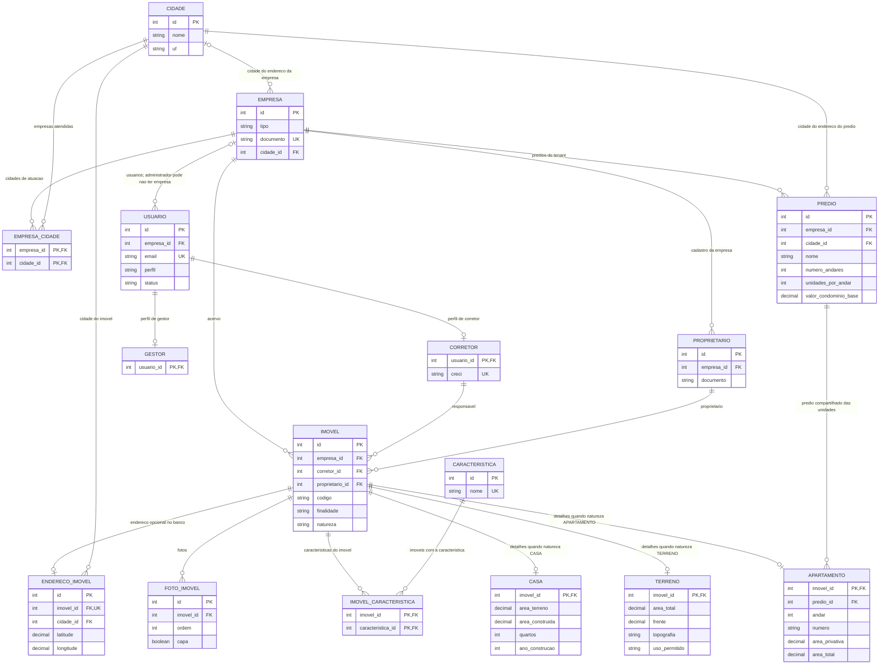

# Arquitetura de dados

Este documento descreve o modelo relacional criado pelas migrations Flyway V1–V16 do `aluguel-imoveis-api`, considerando também as histórias do projeto. As relações e garantias abaixo refletem o SQL dessas migrations. Regras descritas nas histórias que ainda não aparecem no SQL estão identificadas como validações da aplicação ou como itens fora do escopo atual.

## Visão do modelo

`empresa` representa tanto uma imobiliária quanto um corretor autônomo. Usuários, proprietários e imóveis são associados a uma empresa. Cidades e características são catálogos compartilhados. A empresa pode manter uma lista das cidades em que atua, enquanto cada endereço de imóvel aponta para uma cidade.

O cadastro comum do imóvel mantém uma empresa, um corretor responsável, um proprietário e uma finalidade. Endereço, fotos e características ficam em tabelas próprias. O corretor e o gestor são perfis complementares a `usuario`, identificados pelo mesmo `usuario_id`.

No diagrama, `o|` indica zero ou um, `||` indica exatamente um e `o{` indica zero ou muitos. Assim, a relação entre imóvel e endereço é opcional no banco: um imóvel pode não ter linha em `endereco_imovel`, embora cada linha de endereço tenha cidade e coordenadas obrigatórias.

## Entidades e relações

| Migration | Tabela | Papel e relações principais |
| --- | --- | --- |
| V1 | `cidade` | Catálogo de cidades e UFs. Nome e UF formam uma chave única. É referenciada pelo endereço da empresa, pelas cidades de atuação e pelos endereços dos imóveis. |
| V2 | `empresa` | Raiz do tenant, com tipo `IMOBILIARIA` ou `AUTONOMO`. Pode ter uma cidade de endereço (`cidade_id`) e se associa a várias cidades de atuação por `empresa_cidade`. |
| V3 | `empresa_cidade` | Associação muitos-para-muitos entre empresas e cidades. A chave primária composta impede repetir o mesmo par. |
| V4 | `usuario` | Conta de acesso, opcionalmente vinculada a uma empresa apenas para o perfil `ADMINISTRADOR`; os demais perfis exigem `empresa_id`. Perfis aceitos: `ADMINISTRADOR`, `GESTOR`, `CORRETOR` e `CLIENTE`. |
| V5 | `corretor` | Dados do perfil de corretor. `usuario_id` é simultaneamente PK e FK, portanto há no máximo um registro de corretor por usuário. O CRECI é único globalmente nesta tabela. |
| V6 | `gestor` | Marcador de perfil de gestor, também com `usuario_id` como PK e FK para `usuario`. |
| V7 | `proprietario` | Contato do proprietário cadastrado por uma empresa. Documento é único dentro da mesma empresa. |
| V8 | `caracteristica` | Catálogo global de características, com nome único. |
| V9 | `imovel` | Cadastro comum do imóvel. Exige empresa, corretor, proprietário, finalidade e natureza (`CASA`, `TERRENO` ou `APARTAMENTO`); código é único por empresa. |
| V10 | `endereco_imovel` | Endereço ligado a um imóvel e a uma cidade. `UNIQUE (imovel_id)` limita o imóvel a um endereço. CEP, logradouro, número, bairro, cidade, latitude e longitude são obrigatórios quando a linha existe. |
| V11 | `imovel_caracteristica` | Associação muitos-para-muitos entre imóvel e característica, com chave primária composta que impede repetir a associação. |
| V12 | `foto_imovel` | Fotos ordenadas de um imóvel. `UNIQUE (imovel_id, ordem)` impede duas fotos na mesma posição para o mesmo imóvel. |
| V13 | `casa` | Dados específicos da casa, com chave primária e estrangeira para `imovel`. |
| V14 | `terreno` | Dados específicos do terreno, com chave primária e estrangeira para `imovel`. |
| V15 | `predio` | Prédio vinculado a uma empresa, com endereço e dados compartilhados pelas unidades. |
| V16 | `apartamento` | Dados da unidade, relacionados ao imóvel e a um prédio já cadastrado. |

### Cardinalidades e remoções

- Uma empresa pode ter vários usuários, proprietários e imóveis. Cada proprietário e cada imóvel pertencem a exatamente uma empresa no esquema atual.
- Uma empresa pode atuar em várias cidades, e uma cidade pode pertencer à área de atuação de várias empresas. A cidade de endereço da empresa (`empresa.cidade_id`) é uma relação separada da lista `empresa_cidade`.
- Um usuário pode ter zero ou um registro em `corretor` e zero ou um em `gestor`. As chaves não exigem que `usuario.perfil` corresponda à tabela de perfil: por exemplo, o banco não impede um usuário `CLIENTE` de ter uma linha em `corretor`.
- Cada imóvel tem exatamente um corretor e um proprietário referenciados. Um corretor ou proprietário pode estar ligado a vários imóveis.
- Um imóvel pode ter zero ou um endereço, zero ou muitas fotos e zero ou muitas características. Características podem ser usadas em vários imóveis.
- Um imóvel pode ter zero ou um registro em cada tabela de detalhes de natureza; o serviço garante que novos cadastros tenham exatamente os detalhes compatíveis com sua natureza.
- Excluir imóvel exclui em cascata seu endereço, fotos e associações de características. Excluir usuário exclui em cascata as linhas de `corretor` e `gestor`; porém, um corretor referenciado por imóvel não pode ser removido enquanto essa referência existir (`ON DELETE RESTRICT` em `imovel.corretor_id`). Cidades referenciadas e características usadas também têm exclusão restrita. As demais ações de exclusão seguem a ação declarada na FK ou o padrão do banco quando não há cláusula `ON DELETE`.

## O que o banco garante

As migrations criam PKs e FKs para a existência das entidades referenciadas. Também aplicam estas regras:

- `cidade`: combinação `(nome, uf)` única; UF limitada às siglas estaduais previstas na V1.
- `empresa`: tipo limitado a `IMOBILIARIA` ou `AUTONOMO`; tipo de documento limitado a `CPF` ou `CNPJ`, com comprimento compatível; documento único globalmente.
- `usuario`: e-mail único globalmente; perfil e status limitados aos valores previstos; administrador sem empresa e os outros perfis com empresa.
- `corretor`: CRECI único globalmente na tabela de corretores.
- `proprietario`: documento único por empresa; comprimento do documento condicionado ao tipo informado.
- `caracteristica`: nome único globalmente.
- `imovel`: finalidade limitada a `VENDA`, `ALUGUEL` ou `VENDA_E_ALUGUEL`; código único dentro da empresa.
- `imovel.natureza`: obrigatória e limitada a `CASA`, `TERRENO` ou `APARTAMENTO`.
- `casa` e `terreno` usam `imovel_id` como PK e FK e são removidas em cascata com o imóvel.
- `apartamento` usa `imovel_id` como PK e FK, mantém referência obrigatória ao prédio, e é removido em cascata com o imóvel; a exclusão do prédio é restrita enquanto houver apartamentos.
- `predio` pertence a uma empresa e à cidade do seu endereço; o serviço limita as consultas à empresa autenticada.
- `apartamento`: áreas positivas, área total pelo menos igual à área privativa, contagens não negativas e combinação `(predio_id, andar, numero)` única.
- `predio`: número de andares e unidades por andar positivos, ano e elevadores não negativos, condomínio base não negativo e coordenadas dentro dos limites geográficos.
- `casa`: áreas positivas, área construída menor ou igual à área do terreno e contagens/ano não negativos. A área livre não é persistida.
- `terreno`: área e medidas positivas, topografia limitada a `PLANO`, `ACLIVE` ou `DECLIVE`, além de uso permitido não vazio.
- `endereco_imovel`: no máximo um endereço por imóvel e, se cadastrado, cidade e coordenadas não nulas.
- `imovel_caracteristica`: o mesmo par imóvel/característica não pode se repetir.
- `foto_imovel`: a mesma ordem não pode se repetir para um imóvel.

Os checks de documento verificam o tipo e o comprimento, mas não os dígitos, a validade do CPF/CNPJ ou outros critérios de formato. A coluna `ordem` não tem check de intervalo ou sequência. A coluna `capa` não tem unicidade condicional: o banco permite zero, uma ou várias fotos marcadas como capa. O banco também não exige que um imóvel tenha endereço, fotos ou características.

## Multitenancy: garantias e lacunas

`empresa` é a fronteira de tenant usada no cadastro. `usuario`, `proprietario`, `imovel` e `predio` têm `empresa_id`. O banco exige que essas referências apontem para uma empresa existente; em `usuario`, o check adicional torna a empresa obrigatória para gestor, corretor e cliente. `UNIQUE (empresa_id, codigo)` permite que empresas diferentes reutilizem o mesmo código de imóvel sem colisão. `UNIQUE (empresa_id, documento)` permite que o mesmo documento de proprietário exista em empresas diferentes, mas não duas vezes na mesma empresa.

As FKs de `imovel` verificam separadamente que a empresa, o corretor e o proprietário existem. Elas **não** verificam que o corretor e o proprietário pertencem à mesma empresa indicada em `imovel.empresa_id`. Também não há uma FK que assegure que o corretor ligado ao imóvel tenha um usuário com `empresa_id` correspondente, que o usuário autenticado possa operar naquele tenant ou que a cidade do endereço esteja em `empresa_cidade`.

Por isso, o serviço deve derivar o tenant da identidade autenticada e aplicar o filtro `empresa_id` em toda leitura ou alteração do acervo. Deve ainda validar, antes de gravar ou associar referências, que corretor, proprietário, imóvel e prédio pertencem à mesma empresa e que a cidade escolhida está na área de atuação dela. `apartamento.predio_id` tem FK para um prédio existente, mas a igualdade entre `imovel.empresa_id` e `predio.empresa_id` é validada pelo serviço ao vincular a unidade. O `empresa_id` recebido do cliente não deve ser aceito como prova de acesso. A autorização também precisa conferir o perfil e a empresa do usuário; as FKs de `gestor` e `corretor` garantem apenas a existência do usuário.

Alguns campos têm unicidade global apesar da separação por empresa: `usuario.email`, `empresa.documento` e `corretor.creci`. Assim, o banco não permite reutilizar esses valores em tenants distintos. Essa é a regra definida pelo SQL atual.

## Validações que pertencem ao serviço

As histórias do projeto descrevem regras que não estão implementadas por constraints nas V1–V12. O serviço precisa validá-las ao criar, atualizar e publicar imóveis:

- Exigir `valor_venda` para `VENDA` e `valor_aluguel` para `ALUGUEL`. A migration não possui check para a finalidade nem para valores negativos; a regra para `VENDA_E_ALUGUEL` também precisa ser definida e validada.
- Exigir endereço completo e coordenadas antes de publicar. A V10 exige cidade e coordenadas apenas quando `endereco_imovel` existe; a V9 permite imóvel sem endereço. Não há coluna de publicação/status do imóvel nesta série.
- Validar que cidade do endereço faz parte das cidades de atuação da empresa (`empresa_cidade`).
- Impedir que o corretor responsável esteja inativo, e filtrar sua visibilidade pública, conforme a história W02. A inativação está representada pelo status do usuário; a relação entre status, publicação e atribuição de imóveis é regra da aplicação.
- Aplicar a política de fotos de capa da história W04. O banco não garante que exista uma capa, nem que haja no máximo uma. Também cabe ao serviço validar uma ordem útil e não apenas distinta.
- Conferir a correspondência entre `imovel.natureza` e exatamente uma tabela de detalhes. A API valida essa regra no cadastro; as tabelas de detalhes não usam gatilhos para impor coerência entre linhas.
- Calcular a área livre da casa como `area_terreno - area_construida` ao montar o DTO de resposta; esse valor não é recebido nem gravado.
- Criar e atualizar prédios apenas dentro do tenant autenticado e validar se a cidade do endereço está na área de atuação da empresa.
- Vincular o apartamento a um prédio da mesma empresa; seu endereço é apresentado a partir do prédio compartilhado e não é duplicado em `endereco_imovel`.
- Normalizar o número da unidade com trim e maiúsculas antes de validar e salvar; a unicidade no prédio também é protegida por constraint.
- Retornar junto ao detalhe do apartamento os dados atuais do prédio. Como as unidades apontam ao mesmo registro, atualizações do prédio são refletidas nas respostas subsequentes.
- Validar dígitos e checksums de CPF/CNPJ, formatos de e-mail e telefone, CEP, e limites geográficos de latitude e longitude. As colunas e constraints atuais não verificam essas regras.
- Conferir as permissões do perfil logado para cada operação e a coerência entre `usuario.perfil` e as tabelas `gestor`/`corretor`.

## Limites desta versão do esquema

As histórias e a descrição do projeto também mencionam rural, loteamentos com quadras e lotes, publicação na vitrine, contratos, parcelas e documentos. As naturezas casa e terreno livre são implementadas pelas migrations V13 e V14; prédio e apartamento, respectivamente, pelas V15 e V16. Rural e os módulos de loteamento e contratos permanecem fora deste escopo.

## Armazenamento de imagens (WEB EXTRA)

As imagens ficam no sistema de arquivos configurado por `APP_STORAGE_LOCATION` (padrão relativo `uploads`); não foi criada tabela adicional. As associações continuam nos campos existentes `empresa.logomarca_url`, `corretor.foto_url` e `foto_imovel.url`, que guardam URLs do endpoint `/imagens/{tipo}/{entidadeId}/{imagemId}`. O arquivo é separado por tipo e ID da entidade e recebe UUID, sem depender do nome enviado pelo cliente. A API valida formato e tamanho, serve as imagens com o tipo de conteúdo detectado e aplica as regras de tenant nas alterações. Os endpoints e exemplos de consumo estão documentados na seção **Imagens** do `README.md`.

Na divisão do código, `ImagemService` mantém a autorização e associação de imagens aos recursos. O pacote `storage` contém o contrato e a implementação local de armazenamento, a referência de URL gerada e o resultado interno usado para devolver o arquivo. Esses componentes técnicos ficam fora do pacote `service`.
